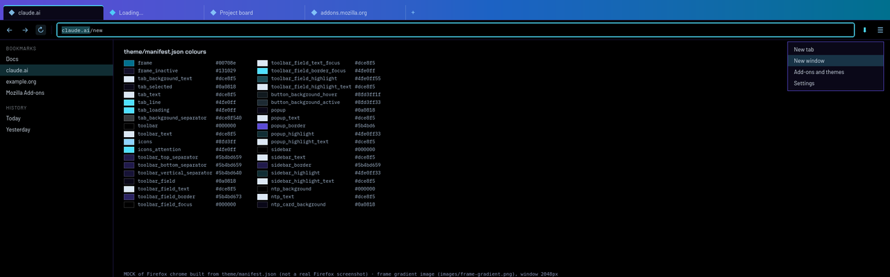

# Valkyrja Night (Firefox theme)

A dark static Firefox theme: an indigo-to-cyan title-bar gradient, true-black toolbar, sidebar and new-tab page, cyan active tab and focus, indigo lines. Colours and one image, no code, no permissions.


*MOCK: an HTML mock-up of Firefox's tab strip, toolbar and sidebar drawn from `theme/manifest.json`, not a Firefox screenshot (headless Firefox can't capture browser chrome).*

Companion to [Valkyrja Night for claude.ai](https://github.com/HrafnaValkyrja/valkyrja-night-claude); each installs on its own.

## Install
- **Firefox Add-ons:** link coming once the listing is approved.
- **From source (temporary):** `about:debugging` → This Firefox → Load Temporary Add-on → pick `theme/manifest.json`.

## Permissions and privacy
| | |
|---|---|
| Permissions | none |
| Code | none (static `theme` manifest: colours + `images/frame-gradient.png`) |
| Network | none |
| Data collection | none |

## Build and test
```sh
npm install
npx playwright install firefox   # only for the preview
npm test          # web-ext lint, manifest check (no permissions, theme only), gradient contrast check, build
npm run preview   # docs/preview.png
```
`tools/gen-frame.py` builds the title-bar gradient and asserts tab text (`#dce8f5`) keeps at least 4.5:1 contrast on every column. Static themes can't stretch images, so it is 2048px wide; `frame` is set to the last colour so wider windows continue without an edge.

## What a static theme can't do
No shapes (tabs keep Firefox's own shape), no fonts, no glows: only the colour keys and images of the [theme manifest](https://developer.mozilla.org/en-US/docs/Mozilla/Add-ons/WebExtensions/manifest.json/theme).

## Contributing
Issues and pull requests welcome; include a before/after image and run `npm test`.

## Licence
[MPL-2.0](LICENSE). See [NOTICE](NOTICE).
